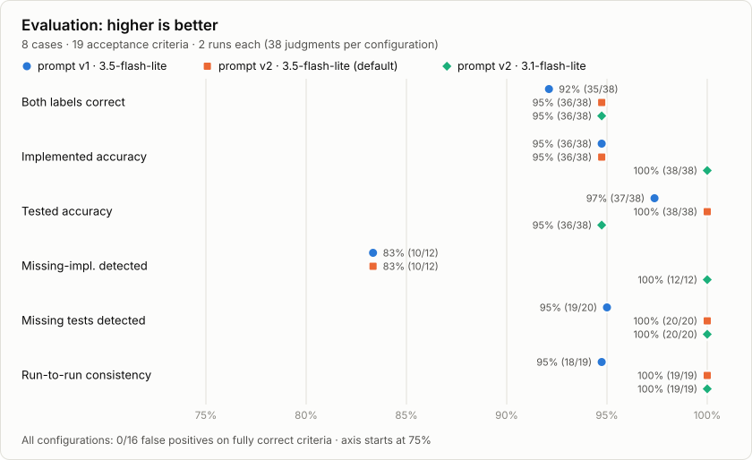
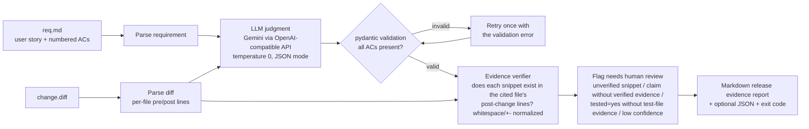

# spec-check

[](https://github.com/wanyan2333/spec-check/actions/workflows/ci.yml)


**Does this change do what the ticket asked, and do the tests actually prove it?**
spec-check gives an LLM a requirement (user story + numbered acceptance criteria) and a
`git diff`. For each criterion it gets back *implemented / tested / evidence*. Then plain
code verifies that every line the LLM quotes as evidence really exists in the diff.
Anything it cannot verify is marked **needs human review**. The output is a Markdown
"release evidence" report and a CI-friendly exit code.

```bash
uv run spec-check --req req.md --diff change.diff --out report.md --fail-on-gaps
```

## At a glance

<picture>
  <source media="(prefers-color-scheme: dark)" srcset="docs/eval-chart-dark.svg">
  
</picture>

- **0 false positives:** across all configurations, no correctly implemented and tested
  criterion was ever reported as a gap. A release gate that cries wolf gets turned off.
- **Caught fabricated evidence automatically:** Gemini twice quoted code that is not in
  the diff ([see below](#what-it-caught-an-llm-quoting-code-that-does-not-exist)). Both quotes
  were flagged before a human could trust them.
- **Prompt v1 → v2**, driven by failure analysis: tested accuracy 97% → 100%, run-to-run
  consistency 95% → 100%, schema repair retries 2 → 0.
- **Honest about the miss:** `gemini-3.5-flash-lite` calls `sum(1 for t in todos.values() if t.done is not None)`
  a correct "done" count with confidence 1.0. It is not one, because `done` is a bool and
  never `None`. With the same prompt, `gemini-3.1-flash-lite` catches it.
- **Ground truth checked by execution:** all 19 labels are verified by hidden behavioral
  probes and mutation testing, not by eye ([how](#how-the-labels-are-verified)).

Full write-up with every failure and the model's own reasoning:
[`eval/RESULTS.md`](eval/RESULTS.md) · Honest development log: [`AI_LOG.md`](AI_LOG.md)

## What it caught: an LLM quoting code that does not exist

Two real examples from the evaluation runs. Each time, the model presented the snippet as
verbatim evidence. The verifier compares quotes against the diff, so it rejected both.

**1. A line silently dropped from a quoted test** (prompt v1, case 08). The model quoted
`test_stats` as one block. The line marked `+` below is in the real code, and the model
left it out:

```diff
  def test_stats():
      client.post("/todos", json={"title": "a"})
      client.post("/todos", json={"title": "b"})
      response = client.get("/todos/stats")
      assert response.status_code == 200
      body = response.json()
+     assert body["total"] == 2
      assert "done" in body
```

**2. A corrupted string literal** (prompt v2, case 06). `-` is what the model quoted, `+`
is the real line in the diff:

```diff
- response = client.post(", json={"title": "Pay rent", "priority": 6})
+ response = client.post("/todos", json={"title": "Pay rent", "priority": 6})
```

This was the *only* test evidence behind a `tested=yes` verdict, so the report also said
*"claims tested=yes without verified evidence from a test file"* → **needs human review**.
The verdict happened to be right. The evidence was not, and the tool said so. Fuzzy matching
would have accepted both quotes, which is why the check is exact after whitespace
normalization.

## The problem

Before a release, someone has to answer two questions for every requirement:

1. **Does the change do what was asked?** Not "does it touch the right file", but does it
   handle the edge cases, both bounds of a range, the 404 for a missing id?
2. **Do the tests actually prove it?** A green test suite is not evidence. A test called
   `test_rejects_too_long_title` that posts an empty title, or a test that asserts
   `"done" in body` without checking the value, passes whether the feature works or not.

LLMs are good at reading a diff against a spec, but they also state wrong answers
confidently and "quote" code that does not exist. spec-check uses the LLM for the judgment
and ordinary code for the verification, and it keeps the two apart in the report.

## How it works



For each acceptance criterion the model returns:

| Field | Meaning |
|-------|---------|
| `implemented` | `yes` / `partial` / `no` |
| `tested` | `yes` only if a test in the diff would fail when the behavior breaks (a test name is not evidence) |
| `evidence` | `[{file, snippet}]`, code quoted from the diff |
| `confidence` | 0 to 1 |
| `reasoning` | one or two sentences |

**Anti-hallucination check** ([`verify.py`](src/spec_check/verify.py)). Every snippet is
checked against the diff: leading `+`/`-` markers are stripped, whitespace is normalized, and
the snippet must appear in the post-change lines (context + added) **of the cited file**.
A snippet from a file that is not in the diff, a snippet that only matches removed lines,
or one that does not exist at all is marked **UNVERIFIED**. A criterion is flagged
**needs human review** if any snippet is unverified, if it claims `implemented` without
verified production-code evidence, if it claims `tested=yes` without verified evidence
*from a test file*, or if the model's confidence is below 0.5.

**Exit codes** (for CI): `0` ok · `1` gaps found with `--fail-on-gaps` (a criterion is not
fully implemented, not tested, or needs human review) · `2` error (bad input, API failure
after retries, unusable model output).

## Quick start

Requires [uv](https://docs.astral.sh/uv/) and a free
[Gemini API key](https://aistudio.google.com/apikey).

```bash
git clone https://github.com/wanyan2333/spec-check.git
cd spec-check
uv sync
cp .env.example .env        # then put your GEMINI_API_KEY in .env
uv run python scripts/list_models.py flash-lite   # optional: see available models

uv run spec-check \
  --req eval/cases/07-mixed/req.md \
  --diff eval/cases/07-mixed/change.diff \
  --out report.md --json report.json --fail-on-gaps
```

Options: `--prompt v1|v2` (default `v2`), `--model <id>` (overrides `SPEC_CHECK_MODEL`),
`-q/--quiet`. Each LLM call's latency and token usage is logged to stderr and listed in the
report. HTTP 429 and 5xx responses are retried with exponential backoff.

Requirement format:

```markdown
# Paginate the todo list

## User story
As a user with a long list, I want `GET /todos` to be paginated so that the app stays fast.

## Acceptance criteria
1. `GET /todos?limit=N` returns at most N todos.
2. `GET /todos?offset=M` skips the first M todos.
3. A `limit` greater than 100 is rejected with 422.
```

## Example report

Real output of the command above for evaluation case
[07-mixed](eval/cases/07-mixed/): the limit is tested, the offset is implemented but has
no test, and the cap of 100 is missing. The full report, with all evidence blocks, is in
[`examples/07-mixed.report.md`](examples/07-mixed.report.md). Exit code: `1`.

> # Release evidence: Paginate the todo list
>
> **Verdict:** ❌ GAPS FOUND in 2 of 3 criteria
>
> Model `gemini-3.5-flash-lite` · prompt `v2` · evidence snippets verified: 4/4 (**0 UNVERIFIED**)
>
> | ID | Acceptance criterion | Implemented | Tested | Confidence | Evidence check |
> |----|----------------------|-------------|--------|------------|----------------|
> | AC1 | `GET /todos?limit=N` returns at most N todos. | yes | yes | 1.00 | ✅ verified |
> | AC2 | `GET /todos?offset=M` skips the first M todos. | yes | no | 1.00 | ✅ verified |
> | AC3 | A `limit` greater than 100 is rejected with 422. | no | no | 1.00 | ✅ verified |
>
> ### AC2: `GET /todos?offset=M` skips the first M todos.
>
> - Implemented: **yes** · Tested: **no** · Confidence: 1.00
> - Reasoning: The implementation correctly applies the offset parameter to slice the items list, but there is no test in the diff verifying offset behavior.
>
> `app.py` (code) — ✅ verified
> ```python
> def list_todos(limit: int = 50, offset: int = 0) -> list[Todo]:
>     items = list(todos.values())
>     return items[offset : offset + limit]
> ```

When evidence fails verification, the report says so explicitly, for example
`` `test_app.py` (test) — ❌ **UNVERIFIED** (snippet not found in this file's diff) `` with a
**Needs human review** line under the criterion.

## Evaluation

8 hand-built cases (19 acceptance criteria) against a small FastAPI todo app. Each
configuration ran every case twice (38 judgments). The cases cover a complete change, a
missed 404 edge case, an untested implementation, a copy-paste test whose name lies, an
unrelated change, a one-sided range check (partial), a mixed case, and a test that only
asserts that a key exists.

| Metric | v1 · 3.5-flash-lite | **v2 · 3.5-flash-lite (default)** | v2 · 3.1-flash-lite |
|--------|------|------|------|
| Both labels correct | 35/38 (92%) | 36/38 (95%) | 36/38 (95%) |
| Implemented accuracy | 36/38 (95%) | 36/38 (95%) | 38/38 (100%) |
| Tested accuracy | 37/38 (97%) | 38/38 (100%) | 36/38 (95%) |
| Missing-implementation detection | 10/12 (83%) | 10/12 (83%) | 12/12 (100%) |
| Missing-test detection | 19/20 (95%) | 20/20 (100%) | 20/20 (100%) |
| False positives on fully correct criteria | 0/16 | 0/16 | 0/16 |
| Unverified (hallucinated) snippets caught | 1/54 | 1/67 | 0/64 |
| Run-to-run consistency | 18/19 | 19/19 | 19/19 |
| Avg latency per check | 2.5 s | 2.4 s | 10.0 s |
| Total tokens (16 checks) | 23.9k | 26.2k | 25.5k |

3.1-flash-lite's two "errors" are a disagreement about a labeling convention. On a
one-sided range check, it reads "tested" as the whole criterion; my labels cover only the
implemented part. Both readings flag the criterion as a gap. Details are in
[`eval/RESULTS.md`](eval/RESULTS.md). The chart at the top is generated from the saved
results by [`eval/make_chart.py`](eval/make_chart.py).

## How the labels are verified

Ground-truth labels for an LLM eval are only as good as the person who wrote them, so every
label here is checked by running code ([`eval/verify_labels.py`](eval/verify_labels.py),
output in [`eval/LABEL_VERIFICATION.md`](eval/LABEL_VERIFICATION.md)):

1. **Real diffs.** [`eval/build_cases.py`](eval/build_cases.py) copies the sample app into
   a temporary git repo, applies the case's real modified files (`after/`) and writes
   `git diff`. The verifier checks that `git apply change.diff` reproduces `after/` exactly.
2. **The defects are invisible to the existing tests.** After applying each change, the
   sample app's test suite passes. That is the situation spec-check is meant to catch.
3. **`implemented`** is checked with hidden behavioral probes (`probes.py`, never shown to
   the model): all pass = yes, some = partial, none = no.
4. **`tested`** is checked with mutation testing: the implementation of each criterion is
   broken (`mutations.json`). The mutation must make that criterion's probe fail; then
   tested = yes if and only if an app test fails.

Result: **19/19 labels confirmed**. To check that the verifier is not simply always
passing, two labels were flipped on purpose, and it rejected both.

## Limitations

- **Text-only review.** The LLM reads the diff; it does not run the code. Semantically wrong
  code that looks right (F1 in RESULTS.md) can be missed with high confidence. The
  verification step proves that quoted code *exists*, not that the model's interpretation
  of it is correct.
- **The diff is the whole world.** Tests or code outside the diff are invisible, so a
  behavior covered by a pre-existing test will be reported as untested.
- **Small eval set** (19 criteria, one toy app), and v2 was tuned on the same cases, so the
  numbers are indicative, not a benchmark.
- **`tested` is binary.** For a partially implemented criterion it is ambiguous whether
  "tested" means the implemented part or the whole criterion.
- Large diffs are sent in one prompt; there is no chunking yet.

## Roadmap

- **GitHub Action** that runs on pull requests, reads acceptance criteria from the linked
  issue, and posts the release evidence report as a PR comment (with `--fail-on-gaps` as an
  optional required check).
- **MCP server** exposing `check_change(requirement, diff)` so coding agents can check their
  own work against the spec before opening a PR.
- **More cases** from real open-source PRs, with a held-out set that is not used for prompt
  tuning.
- **Execution-backed evidence:** generate a probe test per criterion and run it, turning
  "the model thinks it works" into "this check passed".

## How I used AI to build this

I wrote a detailed brief (features, anti-hallucination design, evaluation method and
acceptance standards) and used Claude Code as the coding agent to implement it. Because the
project is about not trusting AI output without verification, I applied the same rule to
the build:

- **Verification over eyeballing.** Instead of hand-checking eval labels, every label is
  verified by running code (behavioural probes plus mutation testing), and the verifier
  itself was tested by deliberately flipping labels.
- **Deterministic parts are unit-tested.** 53 tests mock the LLM entirely (no network, no
  key), covering parsing, verification, retry, report and exit codes in CI.
- **Mistakes were caught and logged.** The agent made real errors (edits that silently did
  nothing because `python` on Windows was a Store stub, a CLI crash on a real 503, a
  relative-path bug in the verifier), and Gemini made some too (confident wrong verdicts,
  corrupted quotes). All are documented in [AI_LOG.md](AI_LOG.md) with how each was
  detected.

## Project layout

```
src/spec_check/     cli, requirement + diff parsing, LLM client, prompts (v1, v2), checker,
                    evidence verifier, report renderer
tests/              unit tests (LLM mocked)
scripts/            list_models.py
eval/sample_app/    FastAPI todo app + tests (subject of the eval)
eval/cases/NN-*/    req.md, change.diff, expected.json, label_notes.md, after/, probes.py, mutations.json
eval/*.py           build_cases.py, verify_labels.py, run_eval.py, make_chart.py
eval/RESULTS.md     evaluation write-up      eval/LABEL_VERIFICATION.md   label check output
examples/           a real report generated by the CLI
docs/               README chart (light and dark SVG)
```

Development checks: `uv run ruff check . && uv run ruff format --check . && uv run pytest`.
CI ([`.github/workflows/ci.yml`](.github/workflows/ci.yml)) runs the same on every push and
pull request, with no secrets.

## License

[MIT](LICENSE)
